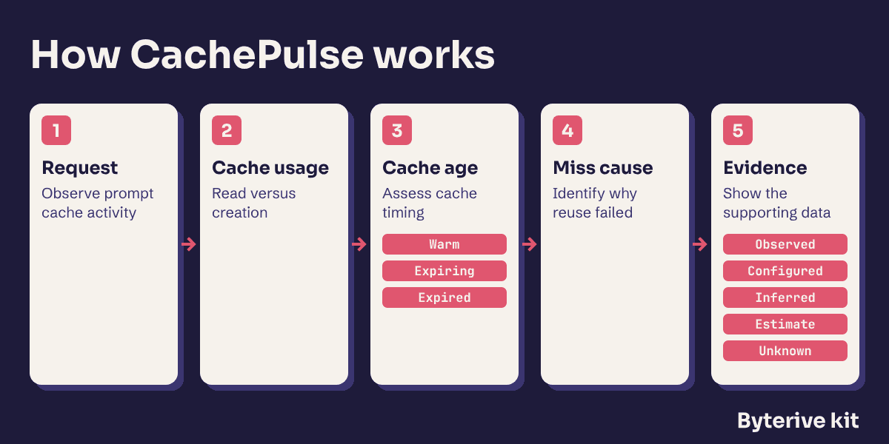
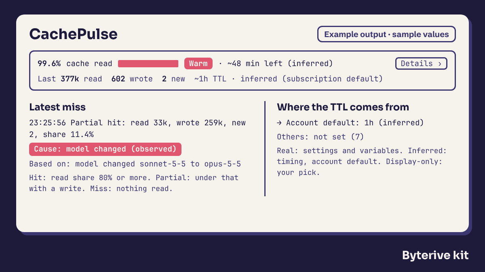

# CachePulse

See whether your prompt cache was reused, and why not.

Status: early. CachePulse uses Claude Code's early-access plugin API, which can change between releases.

## Why it exists

Claude Code keeps your conversation in a prompt cache so each request does not pay full price to re-read it. The cache expires, and it breaks in quiet ways: a model switch, a `/clear`, a compaction, a long pause. You rarely see it happen. You see a slow turn or a larger bill.

CachePulse puts the answer next to the prompt. It shows how much of the last request was read from the cache, how long the cache may last, and, after a miss, the most likely cause with the evidence behind it.



## Install

```
/plugin marketplace add Byterive/kit
/plugin install cachepulse@byterive-kit
```

## Try it

1. Send a few requests, then look at the band above the prompt
   It shows the cache read share as a bar, the cache state and the TTL with its source, and the last request's read, wrote and new tokens.
2. `/cachepulse why`
   After a miss or a partial hit, it gives the likely cause with its evidence.
3. `/cachepulse config`
   It prints the full list of TTL sources with the winner marked, plus the subagent TTL.



## What you get

**A band above the prompt.** Two rows: the cache read share with a bar, the cache state and the TTL with its source, and the last request's read, wrote and new tokens. The bar's length is the read share. Its colour is the time left on the cache.

**A side panel.** Where the TTL comes from, plan usage, recent requests, the latest miss with its cause, and a trend of read share against context size. Subagent requests count in the panel's totals. The band follows the main conversation only.

**An expiry toast.** One minute before a 5m cache may expire. For a 1h cache, ten minutes before as well. It says "may", never "will".

**A model-switch warning.** Switching model rewrites the cache. When Claude Code says the cache was warm, CachePulse warns you at the switch.

**Text commands.** `/cachepulse`, `/cachepulse why`, `/cachepulse theme` and `/cachepulse config`.

## How it reads a request

| Result | Meaning |
|---|---|
| Hit | 80% or more of the input was read from the cache (or some was read and nothing was written) |
| Partial | Some read, under 80%, with something written to the cache |
| Miss | Nothing was read |

After a miss or a partial hit, `/cachepulse why` and the panel give the likely cause: first request since CachePulse loaded, a new session, a `/clear`, a compaction, a model change, caching that appears to be off, a cache lifetime that ran out, new content after the cached part, or no cause found. Each one lists its evidence.

## Where the TTL comes from

CachePulse shows one TTL and says where it came from. It takes the first source that has a value, in this order:

1. Your pick in CachePulse (display only)
2. Timing proof of 1h (inferred)
3. `FORCE_PROMPT_CACHING_5M` (configured)
4. `CLAUDE_CODE_PROMPT_CACHE_TTL` (configured)
5. The `promptCacheTtl` setting (configured)
6. `ENABLE_PROMPT_CACHING_1H` (configured)
7. Timing hint of 5m, the weaker one (inferred)
8. Your account default (inferred)

`/cachepulse config` prints the full list with the winner marked, plus the subagent TTL.

## Honest by design

Every figure carries a label: observed (reported by Claude Code), configured (set in a setting or variable), inferred (a guess from timing or defaults), estimate, or unknown. Values marked inferred are guesses. Nothing is shown as certain unless Claude Code reported it.

## Privacy

- CachePulse uses token counts and timestamps from Claude Code's events. To show where the TTL comes from, it also reads the settings and variables listed under "Where the TTL comes from", plus the subagent TTL variable `CLAUDE_CODE_SUBAGENT_PROMPT_CACHE_TTL` and the `subagentPromptCacheTtl` setting.
- For plan usage, the account default and the cost line, it reads the usage Claude Code reports for the session: plan usage windows and, when given, the session cost.
- Request data is kept in memory for the session, 200 requests at most. Claude Code's plugin store keeps a few small values between sessions: your theme, TTL pick and on or off choices, the last model name, the last reported TTL and the account kind.
- It makes no network requests, starts no processes and writes no files of its own.
- It does not change Claude Code's settings, files or variables.
- The full policy is in [PRIVACY.md](PRIVACY.md).

## Limits

- It uses Claude Code's early-access plugin API, which may change between releases without notice. A Claude Code update can break CachePulse until it is updated.
- The cost line is a list-price estimate, not your bill. Prices come from a table in the plugin, dated 2026-11-10; check Anthropic's published prices for current figures. Models without a price in the table are left out.
- It works only with what the early-access API provides: the events and panes Claude Code gives to plugins.

## Licence

License: MIT. Copyright (c) 2026 Junaid Iqbal (Byterive). See LICENSE.

*Independent project by Byterive. Not affiliated with or endorsed by Anthropic.* · [byterive.com](https://byterive.com)
